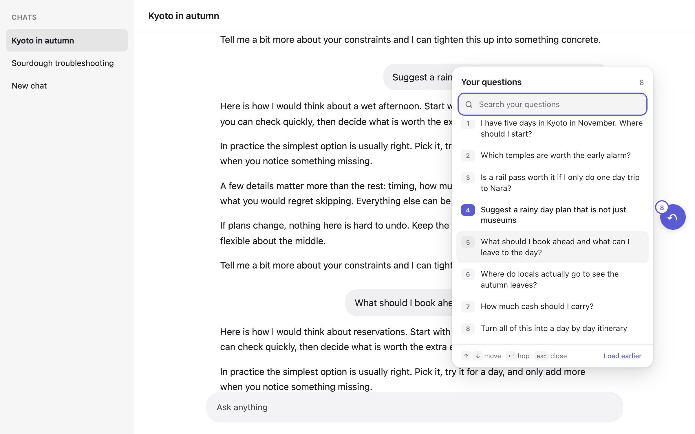
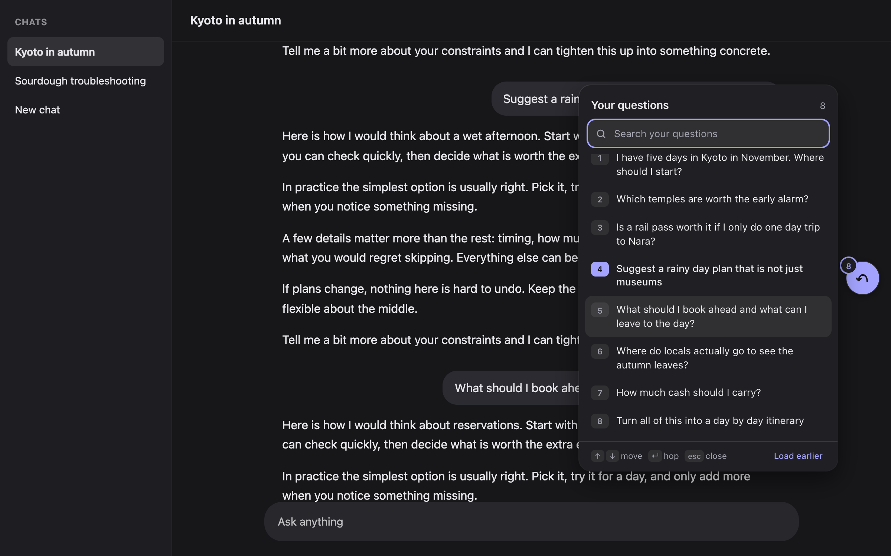
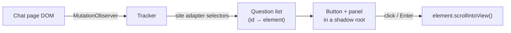

<div align="center">


# HopBack

**Hop back to any question you asked in an AI chat.**

Long answers bury your questions. HopBack lists every question you asked in the current chat<br>
and takes you straight to it. One click, or no clicks at all.

[](https://github.com/sidDarthVader31/hopback/actions/workflows/ci.yml)
[](LICENSE)


<br>


</div>

## Why

You ask something, the model writes four screens, you ask a follow-up, it writes five more. Ten questions in, finding "that thing I asked about rail passes" means dragging a scrollbar and squinting.

HopBack adds one small button to the page. It shows how many questions you have asked, opens a searchable list of them, and scrolls to the one you pick.

## Features

<table>
<tr>
<td width="50%" valign="top">

### Every question, one click away

A numbered list of what you asked, with the one you are currently reading marked. Click to hop; the question flashes so your eye lands on it.

</td>
<td width="50%">

</td>
</tr>
<tr>
<td valign="top">

### Search what you asked

Start typing as soon as the panel opens. Matches are highlighted and <kbd>Enter</kbd> takes you to the first one.

</td>
<td>

</td>
</tr>
<tr>
<td valign="top">

### Hop without opening anything

<kbd>Alt</kbd> <kbd>Shift</kbd> <kbd>↑</kbd> and <kbd>↓</kbd> walk through your questions directly. The first press back takes you to the top of the answer you are reading.

</td>
<td>

</td>
</tr>
<tr>
<td valign="top">

### Follows you between chats

Switch to another conversation and the list is already right, including chats from before you installed HopBack. Nothing is recorded, so there is nothing to sync.

</td>
<td>

</td>
</tr>
<tr>
<td valign="top">

### Looks at home everywhere

Light or dark, HopBack matches the page it is on rather than your system setting. Drag the button up or down if it is in your way; it stays where you leave it.

</td>
<td>

</td>
</tr>
</table>

> The screenshots show HopBack running on a neutral demo page with made-up conversations, generated by `npm run media`.

## Supported sites

| Site | Address | Status |
| --- | --- | --- |
| ChatGPT | `chatgpt.com` | Tested with the extension installed |
| Claude | `claude.ai` | Tested with the extension installed |
| Gemini | `gemini.google.com` | Tested with the extension installed |
| Perplexity | `www.perplexity.ai` | Page layout checked, signed out |
| Grok | `grok.com` | Page layout checked, signed out |

These sites change their layout without notice. If the HopBack button doesn't appear on one of them, please [open a "site broke" issue](https://github.com/sidDarthVader31/hopback/issues/new?template=site_broken.yml).

## Install

HopBack isn't in the Chrome Web Store, so you install it yourself from this repository. It takes about five minutes, and you only do it once.

It works in any Chromium-based browser: Chrome, Brave, Edge, Arc, Opera and Vivaldi. It does not work in Firefox or Safari.

### 1. Install the two tools you need

You need **Git** (to download the code) and **Node.js** (to build it). Open a terminal (on a Mac: <kbd>Cmd</kbd> <kbd>Space</kbd>, type "Terminal"; on Windows: open "PowerShell") and check whether you already have them:

```bash
git --version
node --version
```

If both print a version number, and Node's is 20 or higher, skip to step 2. Otherwise install what's missing:

- **Git:** <https://git-scm.com/downloads>. On a Mac, running `git --version` offers to install it for you.
- **Node.js:** <https://nodejs.org>, the version marked "LTS".

### 2. Download and build HopBack

Run these one at a time in the terminal:

```bash
git clone https://github.com/sidDarthVader31/hopback.git
```

```bash
cd hopback
```

```bash
npm install
```

```bash
npm run build
```

This creates a folder called `dist` inside `hopback`. That folder is the extension.

### 3. Add it to your browser

1. Open your browser's extensions page by typing this into the address bar:

   | Browser | Address |
   | --- | --- |
   | Chrome | `chrome://extensions` |
   | Brave | `brave://extensions` |
   | Edge | `edge://extensions` |
   | Arc, Opera, Vivaldi | `chrome://extensions` |

2. Turn on **Developer mode** (a switch in the top right corner; in Edge it's in the left sidebar).
3. Click **Load unpacked**.
4. Find the `hopback` folder you just downloaded, open it, and select the **`dist`** folder inside it.

HopBack now appears in your list of extensions. To keep its icon handy, click the puzzle piece icon in the toolbar and pin HopBack.

> Keep the `hopback` folder where it is. The browser loads the extension from it each time, so moving or deleting the folder removes the extension.

### 4. Try it

1. Open (or refresh) a chat on any supported site that has at least one question in it.
2. A round button with a number appears on the right edge of the page. The number is how many questions you've asked in this chat.
3. Click it to see your questions, then click one to jump to it.

## How to use it

- **See your questions:** click the round button, click HopBack's icon in the toolbar, or press <kbd>Alt</kbd> <kbd>J</kbd>.
- **Jump to one:** click it in the list. The page scrolls to it and briefly highlights it.
- **Find one in a long chat:** start typing as soon as the list opens; it filters as you type. Press <kbd>Enter</kbd> to jump to the top match.
- **Step through them without the list:** <kbd>Alt</kbd> <kbd>Shift</kbd> <kbd>↑</kbd> and <kbd>↓</kbd>.
- **Move the button:** drag it up or down. It stays where you leave it, on every site.
- **Very long chats:** some sites only load the most recent part of a conversation. Click **Load earlier** at the bottom of the list to pull in the rest.

The button hides itself in a new, empty chat and comes back once you've asked something.

## Keyboard shortcuts

| Shortcut | What it does |
| --- | --- |
| <kbd>Alt</kbd> <kbd>J</kbd>, or the toolbar icon | Open or close the question list |
| <kbd>↑</kbd> <kbd>↓</kbd> | Move through the list |
| <kbd>Enter</kbd> | Hop to the selected question |
| <kbd>Esc</kbd> | Close the list |
| <kbd>Alt</kbd> <kbd>Shift</kbd> <kbd>↑</kbd> | Hop to the previous question |
| <kbd>Alt</kbd> <kbd>Shift</kbd> <kbd>↓</kbd> | Hop to the next question |

On a Mac, <kbd>Alt</kbd> is <kbd>Option</kbd>.

## Updating

When a new version is released, open a terminal in the `hopback` folder and run:

```bash
git pull
```

```bash
npm install
```

```bash
npm run build
```

Then go back to your browser's extensions page, click the reload icon on the HopBack card, and refresh any open chat tabs.

## Troubleshooting

**The button doesn't appear.**

- Refresh the chat tab. Tabs that were already open when you installed or reloaded HopBack don't pick it up until they're refreshed.
- Make sure the chat has at least one question in it. The button hides in empty chats.
- On the extensions page, open HopBack's **Details** and check that **Site access** is set to "On all sites" or "On specific sites" including the one you're on.
- Still nothing? The site may have changed its layout. Please [report it](https://github.com/sidDarthVader31/hopback/issues/new?template=site_broken.yml).

**The list is missing older questions.** Click **Load earlier** at the bottom of the list.

**The browser warns about developer mode extensions.** Some browsers show this for any extension installed this way. It's expected, and you can dismiss it.

**The extension disappeared.** The `hopback` folder was probably moved or deleted. Put it back, or repeat step 2 and step 3.

## Uninstalling

Click **Remove** on the HopBack card on your browser's extensions page, then delete the `hopback` folder.

## Privacy

The full policy is in [PRIVACY.md](PRIVACY.md). In short: HopBack collects nothing, stores nothing about your chats, and makes no network requests.

- Your questions are read from the page when you look at the list and are never saved or sent anywhere.
- The only thing kept is where you dragged the button to (one number, in your browser's local extension storage).
- It runs only on a fixed list of AI chat sites (see `content_scripts` in [manifest.json](manifest.json)). The one permission it asks for is `storage`, for that button position.
- No analytics, no accounts, no remote code. The whole extension is a 17 KB page script (`dist/content.js`) plus a five-line background script that passes toolbar clicks to it.

## How it works



The page itself is the source of truth. Each site already renders your messages as recognisable elements, so HopBack finds them with a per-site selector and keeps a reference to each one. Hopping is `scrollIntoView()` on that element, which stays correct while answers stream in and the layout moves. Storing scroll positions would not.

Because nothing is recorded, switching chats needs no bookkeeping: when the conversation changes, the list is rebuilt from what is on screen.

The UI lives in a shadow root so the site's styles can't leak in and HopBack's can't leak out. No framework; the UI is plain TypeScript and CSS.

## Development

```bash
npm run watch       # rebuild on change (then reload the extension)
npm test            # unit tests (Vitest + happy-dom)
npm run e2e         # browser tests: real Chromium with the built extension loaded
npm run check       # typecheck, lint, unit and browser tests
npm run media       # regenerate README screenshots and GIFs
npm run zip         # build and package dist/ as release/hopback-<version>.zip
```

The browser tests serve stand-in pages at the real hostnames, so the manifest's match patterns and the content script are exercised exactly as shipped, with no accounts or network needed.

```
src/
  adapters/   one small data object per site (selectors, header height)
  core/       tracker, hop, scroll position, text and search helpers
  ui/         button, panel, theme detection, styles
tests/
  fixtures/   stand-in pages for each site
  unit/  e2e/  media/
```

### Adding a site

Most sites need only an entry in [`src/adapters/index.ts`](src/adapters/index.ts), a line in `manifest.json` and a fixture. See [CONTRIBUTING.md](CONTRIBUTING.md#adding-a-site).

## Roadmap

- [ ] Full test of Perplexity and Grok with the extension installed
- [ ] More sites
- [ ] Firefox build
- [ ] Optional local history to search questions across chats

## Contributing

Bug reports, site fixes and new adapters are very welcome. Please read [CONTRIBUTING.md](CONTRIBUTING.md) and the [Code of Conduct](CODE_OF_CONDUCT.md) first. For security issues see [SECURITY.md](SECURITY.md).

## License

[MIT](LICENSE) © Siddharth Bisht

HopBack is an independent project and is not affiliated with or endorsed by OpenAI, Anthropic, Google, Perplexity or xAI.
