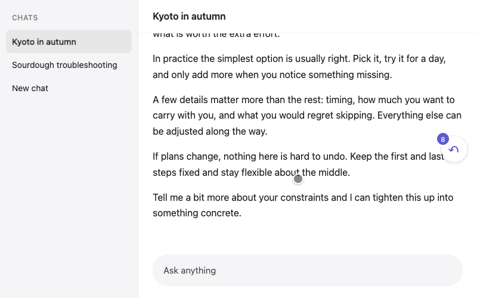
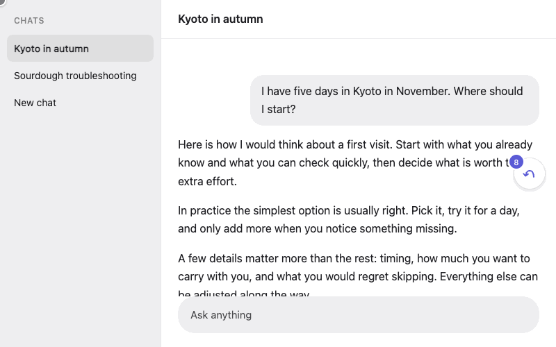
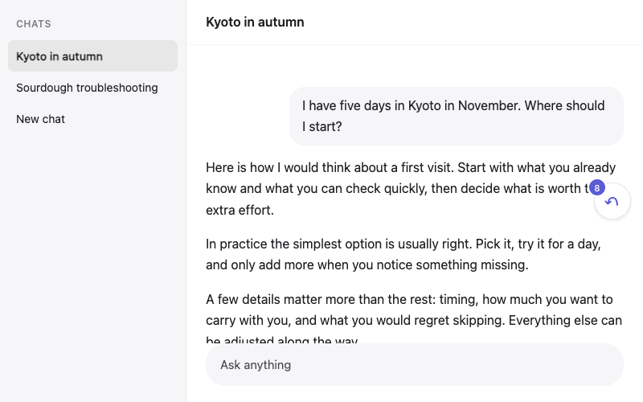
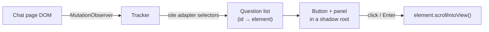

<div align="center">


# HopBack

**Hop back to any question you asked in an AI chat.**

Long answers bury your questions. HopBack lists every question you asked in the current chat<br>
and takes you straight to it. One click, or no clicks at all.

[](https://github.com/sidDarthVader31/hopback/actions/workflows/ci.yml)
[](LICENSE)


<br>



</div>

## Why

You ask something, the model writes four screens, you ask a follow-up, it writes five more. Ten questions in, finding "that thing I asked about rail passes" means dragging a scrollbar and squinting.

HopBack adds one small button to the page. It shows how many questions you have asked, opens a searchable list of them, and scrolls to the one you pick.

## Features

<table>
<tr>
<td width="50%" valign="top">

### Every question, one click away

A numbered list of what you asked, with the one you are currently reading marked. Click to hop; the question flashes so your eye lands on it.

</td>
<td width="50%">

</td>
</tr>
<tr>
<td valign="top">

### Search what you asked

Start typing as soon as the panel opens. Matches are highlighted and <kbd>Enter</kbd> takes you to the first one.

</td>
<td>

</td>
</tr>
<tr>
<td valign="top">

### Hop without opening anything

<kbd>Alt</kbd> <kbd>Shift</kbd> <kbd>↑</kbd> and <kbd>↓</kbd> walk through your questions directly. The first press back takes you to the top of the answer you are reading.

</td>
<td>

</td>
</tr>
<tr>
<td valign="top">

### Follows you between chats

Switch to another conversation and the list is already right, including chats from before you installed HopBack. Nothing is recorded, so there is nothing to sync.

</td>
<td>

</td>
</tr>
<tr>
<td valign="top">

### Looks at home everywhere

Light or dark, HopBack matches the page it is on rather than your system setting. Drag the button up or down if it is in your way; it stays where you leave it.

</td>
<td>

</td>
</tr>
</table>

> The screenshots show HopBack running on a neutral demo page with made-up conversations, generated by `npm run media`.

## Supported sites

| Site | Address | Status |
| --- | --- | --- |
| ChatGPT | `chatgpt.com` | Selectors checked on the live site (Nov 2026) |
| Gemini | `gemini.google.com` | Selectors checked on the live site (Nov 2026) |
| Perplexity | `www.perplexity.ai` | Selectors checked on the live site (Nov 2026) |
| Grok | `grok.com` | Selectors checked on the live site (Nov 2026) |
| Claude | `claude.ai` | Automated tests pass; live check pending |
| DeepSeek | `chat.deepseek.com` | Automated tests pass; live check pending |
| Copilot | `copilot.com`, `copilot.microsoft.com` | Automated tests pass; live check pending |

"Automated tests pass" means the extension works end to end on a stand-in page that copies the site's markup. "Selectors checked" means the markup HopBack looks for was confirmed on the real site, signed out. These sites change their markup without notice, so the full "live check" is a manual pass with the extension installed ([checklist](CONTRIBUTING.md#live-check)). If HopBack's button doesn't appear on a supported site, please [open a "site broke" issue](https://github.com/sidDarthVader31/hopback/issues/new?template=site_broken.yml).

## Install

HopBack isn't on the Chrome Web Store yet. To run it from source:

```bash
git clone https://github.com/sidDarthVader31/hopback.git
cd hopback
npm install
npm run build
```

Then open `chrome://extensions`, turn on **Developer mode**, choose **Load unpacked** and select the `dist` folder. Works in Chrome, Edge, Brave, Arc and other Chromium browsers.

## Keyboard shortcuts

| Shortcut | What it does |
| --- | --- |
| <kbd>Alt</kbd> <kbd>J</kbd>, or the toolbar icon | Open or close the question list |
| <kbd>↑</kbd> <kbd>↓</kbd> | Move through the list |
| <kbd>Enter</kbd> | Hop to the selected question |
| <kbd>Esc</kbd> | Close the list |
| <kbd>Alt</kbd> <kbd>Shift</kbd> <kbd>↑</kbd> | Hop to the previous question |
| <kbd>Alt</kbd> <kbd>Shift</kbd> <kbd>↓</kbd> | Hop to the next question |

On a Mac, <kbd>Alt</kbd> is <kbd>Option</kbd>.

## Privacy

HopBack collects nothing, stores nothing about your chats, and makes no network requests.

- Your questions are read from the page when you look at the list and are never saved or sent anywhere.
- The only thing kept is where you dragged the button to (one number, in your browser's local extension storage).
- It runs only on the sites listed above. The one permission it asks for is `storage`, for that button position.
- No analytics, no accounts, no remote code. The whole extension is a 17 KB page script (`dist/content.js`) plus a five-line background script that passes toolbar clicks to it.

## How it works



The page itself is the source of truth. Each site already renders your messages as recognisable elements, so HopBack finds them with a per-site selector and keeps a reference to each one. Hopping is `scrollIntoView()` on that element, which stays correct while answers stream in and the layout moves. Storing scroll positions would not.

Because nothing is recorded, switching chats needs no bookkeeping: when the conversation changes, the list is rebuilt from what is on screen.

The UI lives in a shadow root so the site's styles can't leak in and HopBack's can't leak out. No framework; the UI is plain TypeScript and CSS.

## Development

```bash
npm run watch       # rebuild on change (then reload the extension)
npm test            # unit tests (Vitest + happy-dom)
npm run e2e         # browser tests: real Chromium with the built extension loaded
npm run check       # typecheck, lint, unit and browser tests
npm run media       # regenerate README screenshots and GIFs
```

The browser tests serve stand-in pages at the real hostnames, so the manifest's match patterns and the content script are exercised exactly as shipped, with no accounts or network needed.

```
src/
  adapters/   one small data object per site (selectors, header height)
  core/       tracker, hop, scroll position, text and search helpers
  ui/         button, panel, theme detection, styles
tests/
  fixtures/   stand-in pages for each site
  unit/  e2e/  media/
```

### Adding a site

Most sites need only an entry in [`src/adapters/index.ts`](src/adapters/index.ts), a line in `manifest.json` and a fixture. See [CONTRIBUTING.md](CONTRIBUTING.md#adding-a-site).

## Roadmap

- [ ] Live check of Claude, DeepSeek and Copilot (they need an account)
- [ ] Chrome Web Store listing
- [ ] Firefox build
- [ ] Optional local history to search questions across chats

## Contributing

Bug reports, site fixes and new adapters are very welcome. Please read [CONTRIBUTING.md](CONTRIBUTING.md) and the [Code of Conduct](CODE_OF_CONDUCT.md) first. For security issues see [SECURITY.md](SECURITY.md).

## License

[MIT](LICENSE) © Siddharth Bisht

HopBack is an independent project and is not affiliated with or endorsed by OpenAI, Anthropic, Google, Perplexity, DeepSeek, xAI or Microsoft.
